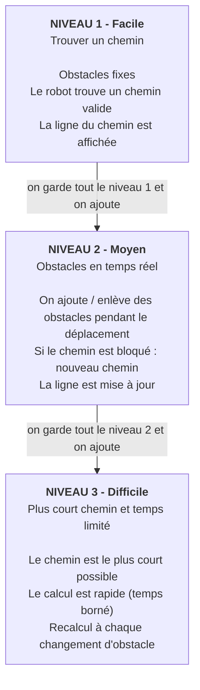

# Navigation intelligente d'un robot dans un environnement dynamique

Projet de groupe - Thème 2

## But du projet

Un robot se déplace sur une **grille** depuis un point de départ jusqu'à une destination, en évitant les obstacles. L'interface affiche la grille, le robot, la destination, les obstacles et le chemin (une ligne qui relie le robot à la destination en contournant les obstacles).

## La grille

La grille est le terrain du robot : un quadrillage fait de cases.

| Symbole | Signification | Valeur dans le code |
|---|---|---|
| `.` | case libre | 0 |
| `#` | obstacle | 1 |
| `R` | robot (départ) | position (ligne, colonne) |
| `D` | destination | position (ligne, colonne) |

Exemple :

```
R . . . .
. # # . .
. . # . .
. . . . D
```

## Schéma du travail



## Détail de chaque niveau

### Niveau 1 - Facile : recherche d'un chemin

**Objectif :** trouver un chemin valide entre le départ et la destination avec des obstacles fixes.

**À faire :**
- [ ] Créer la grille avec des obstacles fixes
- [ ] Placer le robot et la destination
- [ ] Écrire l'algorithme de recherche de chemin
- [ ] Afficher la grille dans une fenêtre
- [ ] Dessiner la ligne du chemin (robot vers destination)
- [ ] Préparer des grilles de test (simple, avec impasse, sans chemin possible)

**Résultat attendu :** on lance le programme, on voit la grille et la ligne qui contourne les obstacles.

---

### Niveau 2 - Moyen : obstacles en temps réel

**Objectif :** des obstacles peuvent apparaître ou disparaître pendant que le robot avance.

**À faire :**
- [ ] Faire avancer le robot case par case le long du chemin
- [ ] Ajouter / enlever un obstacle avec un clic de souris
- [ ] Détecter quand le chemin prévu est bloqué
- [ ] Recalculer un nouveau chemin depuis la position actuelle du robot
- [ ] Mettre à jour la ligne affichée
- [ ] Tester plusieurs cas (obstacle devant le robot, obstacle qui disparaît, destination bloquée)

**Résultat attendu :** on clique sur une case devant le robot, elle devient un mur, et la ligne change pour l'éviter.

---

### Niveau 3 - Difficile : plus court chemin sous contrainte de temps

**Objectif :** trouver le **plus court** chemin, avec un temps de calcul limité, et le recalculer à chaque changement d'obstacle.

**À faire :**
- [ ] Utiliser un algorithme qui garantit le plus court chemin (A* ou Dijkstra)
- [ ] Limiter le temps de calcul
- [ ] Recalculer le chemin optimal à chaque changement
- [ ] Mesurer : temps de calcul, longueur du chemin, nombre de cases explorées
- [ ] (Facultatif) Comparer plusieurs algorithmes
- [ ] (Facultatif) Afficher les chiffres à côté de la grille

**Résultat attendu :** le robot suit toujours le chemin le plus court, même quand les obstacles changent.
